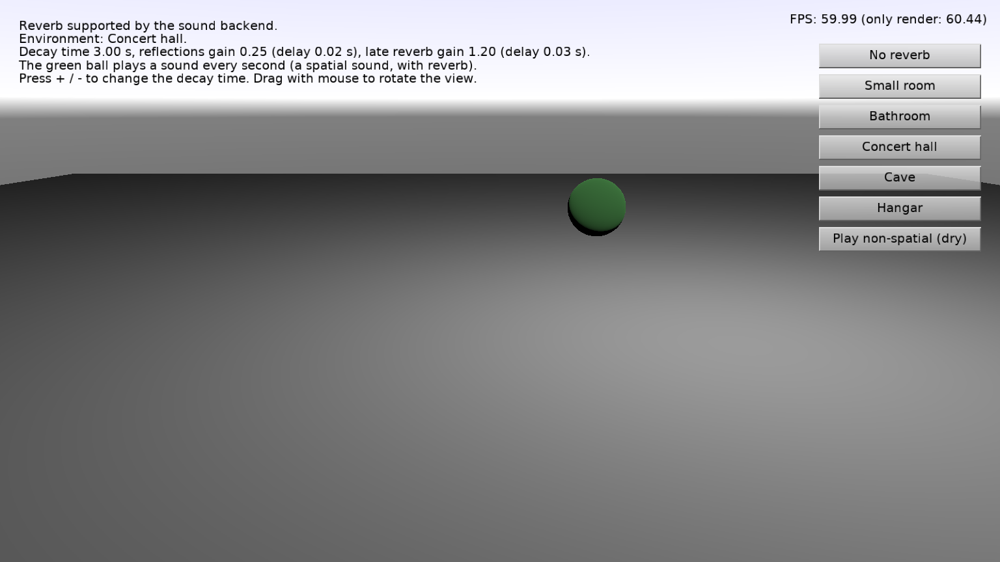

# Sound Reverb

Reverb (reverberation): the echoes of a room, a hall or a cave added to spatial sounds, using [SoundEngine.Reverb](https://castle-engine.io/api?id=TSoundEngine.Reverb).

Keys:

- _+_ / _-_: change the decay time (how long the reverb lasts).
- Drag with the mouse to rotate the view (follows [TCastleExamineNavigation](https://castle-engine.io/api?id=TCastleExamineNavigation)).

## How it works

The green ball (with a [TCastleSoundSource](https://castle-engine.io/api?id=TCastleSoundSource) behavior, in the design file) plays a short spatial sound every second. The buttons set the parameters of [TCastleSoundReverb](https://castle-engine.io/api?id=TCastleSoundReverb) to a few environments, see [code/gameviewmain.pas](code/gameviewmain.pas). _"Play non-spatial"_ plays the same sound as non-spatial: the reverb doesn't affect it.

The reverb needs a sound backend that supports it, see [SoundEngine.ReverbSupported](https://castle-engine.io/api?id=TSoundEngine.ReverbSupported). Right now this is the OpenAL backend with the EFX extension ([OpenAL Soft](https://openal-soft.org/) has it). Without it, the reverb is ignored.

Sound `data/blip.wav` by Lokif, CC0, see [data/AUTHORS.txt](data/AUTHORS.txt).

## Building

Compile by:

- [CGE editor](https://castle-engine.io/editor). Just use menu items _"Compile"_ or _"Compile And Run"_.

- Or use [CGE command-line build tool](https://castle-engine.io/build_tool). Run `castle-engine compile` in this directory.

- Or use [Lazarus](https://www.lazarus-ide.org/). Open in Lazarus `sound_reverb_standalone.lpi` file and compile / run from Lazarus. Make sure to first register [CGE Lazarus packages](https://castle-engine.io/lazarus).

- Or use [Delphi](https://www.embarcadero.com/products/Delphi). Open in Delphi `sound_reverb_standalone.dproj` file and compile / run from Delphi. See [CGE and Delphi](https://castle-engine.io/delphi) documentation for details.
