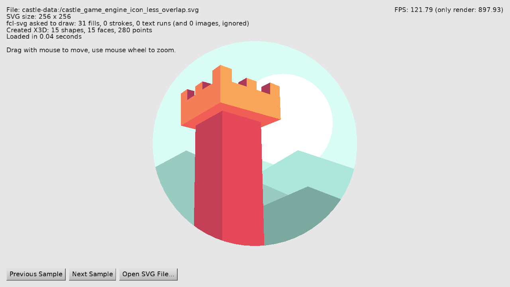

# Display SVG in Castle Game Engine

Display SVG files as vector graphics (no rasterization, everything is rendered using primitives and can be scaled without losing quality). Uses [`TCastleScene` and `TCastleViewport`](https://castle-engine.io/viewport_and_scenes) to render, just like any other model in _Castle Game Engine_.

The unit [code/gameloadsvg.pas](code/gameloadsvg.pas) registers SVG as a model format in its `initialization`. To use it in your projects, just copy this unit, use it from anywhere (like from `GameInitialize`), and then you can just load SVG files into a scene:

```pascal
MyScene.Url := 'castle-data:/my.svg';
```



## Requires latest FPC (from "main" branch), with fcl-svg

**To actually read SVG files, this example must be compiled with the latest [Free Pascal Compiler](https://www.freepascal.org/) from the [main branch on GitLab](https://gitlab.com/freepascal.org/fpc/source)**, from October 2026 or newer. It uses the `fcl-svg` package, which was added to FPC in late September 2026.

- With **FPC 3.2.2** (or any other stable FPC release, as of now) or with **Delphi**, the example compiles, but reading SVG only shows an error.

- With FPC 3.3.1 from "main" branch _older_ than late September 2026, the example doesn't compile (it will not find `fcl-svg` units). Upgrade FPC.

You can get the latest FPC e.g. using [fpcupdeluxe](https://castle-engine.io/fpcupdeluxe) (choose FPC "trunk" / "main") or by [compiling FPC from source yourself](https://gitlab.com/freepascal.org/fpc/source).

## How it works

The SVG is read and laid out by `fcl-svg`, which calls our backend (a `TSVGRenderBackend` descendant) to draw paths. Our backend turns them into X3D nodes (shapes with polygons), which is how _Castle Game Engine_ represents everything it renders. See [code/gameloadsvg.pas](code/gameloadsvg.pas) for the implementation and the list of current simplifications (no fill-rule / holes, gradients approximated by per-vertex colors, clipping by convex hull, no masks / filters / patterns / images).

As a consequence of the simplifications, you may see warnings _"Triangulation of concave polygon failed"_ for some SVG files: these are SVG paths that are self-intersecting, which our polygons cannot express.

## Sample SVG files

- `data/castle_game_engine_icon_less_overlap.svg`: _Castle Game Engine_ logo.
- `data/fpc/*.svg`: samples from [fcl-svg](https://gitlab.com/freepascal.org/fpc/source/-/tree/main/packages/fcl-svg/examples/SVG).

Use _"Open SVG File..."_ to view any other SVG file.

See [data/AUTHORS.txt](data/AUTHORS.txt) for details.

Using [Castle Game Engine](https://castle-engine.io/).

## Building

Compile (with the latest FPC, see above, to actually read SVG files) by:

- [CGE editor](https://castle-engine.io/editor). Just use menu items _"Compile"_ or _"Compile And Run"_.

- Or use [CGE command-line build tool](https://castle-engine.io/build_tool). Run `castle-engine compile` in this directory.

- Or use [Lazarus](https://www.lazarus-ide.org/). Open in Lazarus `svg_standalone.lpi` file and compile / run from Lazarus. Make sure to first register [CGE Lazarus packages](https://castle-engine.io/lazarus).

- Or use [Delphi](https://www.embarcadero.com/products/Delphi). Open in Delphi `svg_standalone.dproj` file and compile / run from Delphi. See [CGE and Delphi](https://castle-engine.io/delphi) documentation for details. (But reading SVG is not possible with Delphi, see above.)
