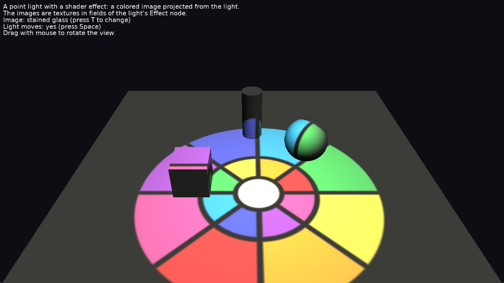

# Shader Effects: Light Projection

[Shader effect](https://castle-engine.io/shaders) on a light source that uses a texture: the light's color is multiplied by an image projected downwards from the light, like a projector, or sunlight through a stained glass window.

Keys:

- _T_: change the projected image (stained glass, window panes, blinds).
- _Space_: stop / resume moving the light.
- Drag with the mouse to rotate the view (follows [TCastleExamineNavigation](https://castle-engine.io/api?id=TCastleExamineNavigation)).

## How it works

The light is in a separate scene from the objects it lights, which is common when lights are placed separately from the level geometry. The design file has:

- `LightScene`, with [CastGlobalLights](https://castle-engine.io/api?id=TCastleScene.CastGlobalLights) = `true`, loads [data/projector_light.x3dv](data/projector_light.x3dv): a point light with an `Effect` in its `effects` field. The effect's fields are uniforms in the shader [data/shaders/projected_light.fs](data/shaders/projected_light.fs). The fields holding an `ImageTexture` are `sampler2D` uniforms. The shader defines `PLUG_light_color_scale`, to multiply the light's color by the image.

- `LitScene` loads [data/lit_objects.x3dv](data/lit_objects.x3dv): the lit objects, with Phong shading and the `EyeWorldSpace` shader library that the light's effect needs.

The code ([code/gameviewmain.pas](code/gameviewmain.pas)) moves the light and changes the image, sending new values of the effect's fields to the shader.

See [compositing shaders](https://castle-engine.io/compositing_shaders.php) for more information about effects on lights.

## Building

Compile by:

- [CGE editor](https://castle-engine.io/editor). Just use menu items _"Compile"_ or _"Compile And Run"_.

- Or use [CGE command-line build tool](https://castle-engine.io/build_tool). Run `castle-engine compile` in this directory.

- Or use [Lazarus](https://www.lazarus-ide.org/). Open in Lazarus `shader_effects_light_projection_standalone.lpi` file and compile / run from Lazarus. Make sure to first register [CGE Lazarus packages](https://castle-engine.io/lazarus).

- Or use [Delphi](https://www.embarcadero.com/products/Delphi). Open in Delphi `shader_effects_light_projection_standalone.dproj` file and compile / run from Delphi. See [CGE and Delphi](https://castle-engine.io/delphi) documentation for details.
