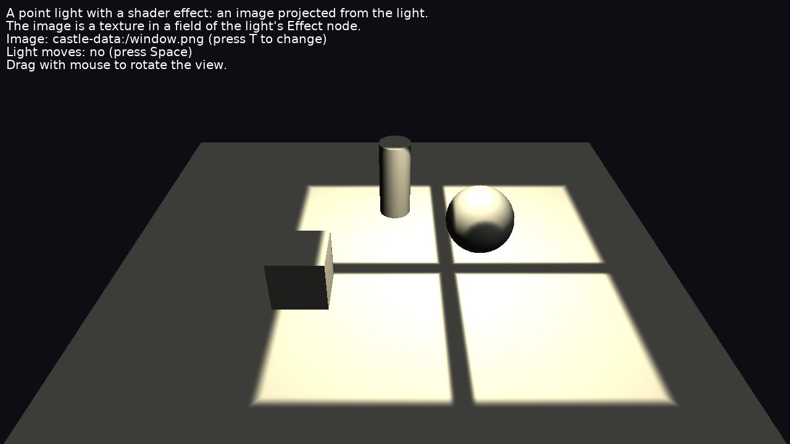

# Shader Effects On Light

A shader effect on a light source that uses a **texture**: the light is multiplied by an image projected downwards from the light, like a projector, or sunlight through a window. Press _T_ to switch between the images (window panes, blinds).



The light is in a separate scene (`LightScene`, with `CastGlobalLights` = `true`) from the objects it lights (`LitScene`). This is the common setup when lights are placed separately from the level geometry (for example a game's light entities, or lights shared by many scenes).

Keys:

- _T_: change the projected image (the texture in the light's effect, changed at runtime).
- _Space_: stop / resume moving the light.
- Drag with the mouse to rotate the view.

## How it works

X3D lights have an `effects` field (see [Compositing Shaders in X3D](https://castle-engine.io/compositing_shaders.php)). An `Effect` node there can define `PLUG_light_scale`, a GLSL function that scales the light's contribution at each lit point:

```glsl
void PLUG_light_scale(inout float scale, const in vec3 normal_eye, const in vec3 light_dir)
```

The effect's fields become GLSL uniforms. A field holding a texture node (`SFNode` or `MFNode` with `ImageTexture`, `PixelTexture`...) becomes a `sampler2D` (or another sampler type, following the texture), bound by the renderer.

In this example ([gameviewmain.pas](code/gameviewmain.pas)):

```delphi
LightEffect := TEffectNode.Create;
LightEffect.Language := slGLSL;
// sampler2D projection_texture
LightEffect.AddCustomField(TSFNode.Create(LightEffect, true, 'projection_texture',
  [TAbstractTextureNode], WindowTexture));
// vec3 light_position
LightEffect.AddCustomField(TSFVec3f.Create(LightEffect, true, 'light_position',
  Vector3(0, 6, 0)));
Part := TEffectPartNode.Create;
Part.ShaderType := stFragment;
Part.SetUrl(['castle-data:/shaders/projected_light.fs']);
LightEffect.SetParts([Part]);

Light := TPointLightNode.Create;
Light.Global := true;
Light.SetEffects([LightEffect]);
```

The shader ([data/shaders/projected_light.fs](data/shaders/projected_light.fs)) computes the world position of the lit point, projects it from the light into the image, and multiplies `scale` by the texture.

### World position of the lit point

The light effect gets the point in eye space (`castle_vertex_eye`, available with Phong shading). To convert it to world space, it needs `castle_CameraInverseMatrix`, which comes from the `EyeWorldSpace` shader library. Shader libraries are enabled by effects on the lit shapes, so the lit scene has an `Effect` (without code) using it:

```delphi
EyeWorldSpace := TEffectNode.Create;
EyeWorldSpace.Language := slGLSL;
EyeWorldSpace.FdShaderLibraries.Items.Add('castle-shader:/EyeWorldSpace.glsl');
LitSceneRoot.AddChildren(EyeWorldSpace);
```

and Phong shading: `LitScene.RenderOptions.PhongShading := true`.

### Updating the uniforms

Change the effect's fields with `Send` (not by setting `Value`), so the renderer updates the uniforms: this example sends the light position every frame, and a new texture when you press _T_. The scene containing the light needs `ProcessEvents` = `true`.

## Textures of lights from other scenes

Textures must be prepared (loaded to the GPU) before they are bound. Each shape prepares the textures it uses, including the textures in effects of the lights of its own scene. A global light from another scene (`TCastleScene.CastGlobalLights`) can light shapes in any scene, so `TCastleScene` now also prepares the textures used by its global lights' effects (and `EnvironmentLight` textures) when rendering and in `PrepareResources`. Before, such textures were not prepared, so their samplers were not bound and the light effect didn't see the image.

## Limitations

- `PLUG_light_scale` scales the light's intensity by a single number, so the projected image is grayscale (this example uses the red channel). A colored projection would need a plug that changes the light's color.
- The textures of a light are prepared when the scene containing the light is rendered (it does not need to be visible in the frustum: a scene with only lights is fine) or prepared with `TCastleViewport.PrepareResources`.

## Building

Compile by:

- [CGE editor](https://castle-engine.io/editor). Just use menu items _"Compile"_ or _"Compile And Run"_.

- Or use [CGE command-line build tool](https://castle-engine.io/build_tool). Run `castle-engine compile` in this directory.

- Or use [Lazarus](https://www.lazarus-ide.org/). Open in Lazarus `shader_effects_on_light_standalone.lpi` file and compile / run from Lazarus. Make sure to first register [CGE Lazarus packages](https://castle-engine.io/lazarus).

- Or use [Delphi](https://www.embarcadero.com/products/Delphi). Open in Delphi `shader_effects_on_light_standalone.dproj` file and compile / run from Delphi. See [CGE and Delphi](https://castle-engine.io/delphi) documentation for details.
