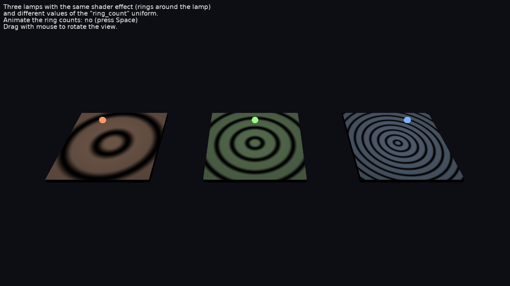

# Shader Effects On Lights

[Shader effects](https://castle-engine.io/shaders) on light sources: the light of each lamp shines in rings around it, like light through a patterned lampshade.

Keys:

- _Space_: animate the ring counts.
- Drag with the mouse to rotate the view (follows [TCastleExamineNavigation](https://castle-engine.io/api?id=TCastleExamineNavigation)).

## How it works

Three lamps are setup in the design file, using [TCastlePointLight](https://castle-engine.io/api?id=TCastlePointLight) component. Each lamp uses a `Radius` to  reach only its own tile.

Each lamp gets a shader effect using [TCastleAbstractLight.SetEffects](https://castle-engine.io/api?id=TCastleAbstractLight.SetEffects). All effects use the same GLSL code, [data/shaders/rings_light.fs](data/shaders/rings_light.fs), with a different value of the `ring_count` uniform, so every tile shows a different number of rings.

The fields of the `Effect` node are uniforms in the shader. To change a uniform value from Pascal, we use `RingCount.Send(...)`.

Each lamp has its own `Effect` node, so each lamp can have different uniform values. Shapes lit by lights with different `Effect` nodes use different shader programs.

Note: If many lights should use the same effect with the same uniform values, you could give them the same `Effect` node. This is *not* what happens in this example, where each lamp has its own `Effect` node with different uniform values.

See [shaders documentation](https://castle-engine.io/shaders) for more information about shader effects.

## Building

Compile by:

- [CGE editor](https://castle-engine.io/editor). Just use menu items _"Compile"_ or _"Compile And Run"_.

- Or use [CGE command-line build tool](https://castle-engine.io/build_tool). Run `castle-engine compile` in this directory.

- Or use [Lazarus](https://www.lazarus-ide.org/). Open in Lazarus `shader_effects_on_lights_standalone.lpi` file and compile / run from Lazarus. Make sure to first register [CGE Lazarus packages](https://castle-engine.io/lazarus).

- Or use [Delphi](https://www.embarcadero.com/products/Delphi). Open in Delphi `shader_effects_on_lights_standalone.dproj` file and compile / run from Delphi. See [CGE and Delphi](https://castle-engine.io/delphi) documentation for details.
