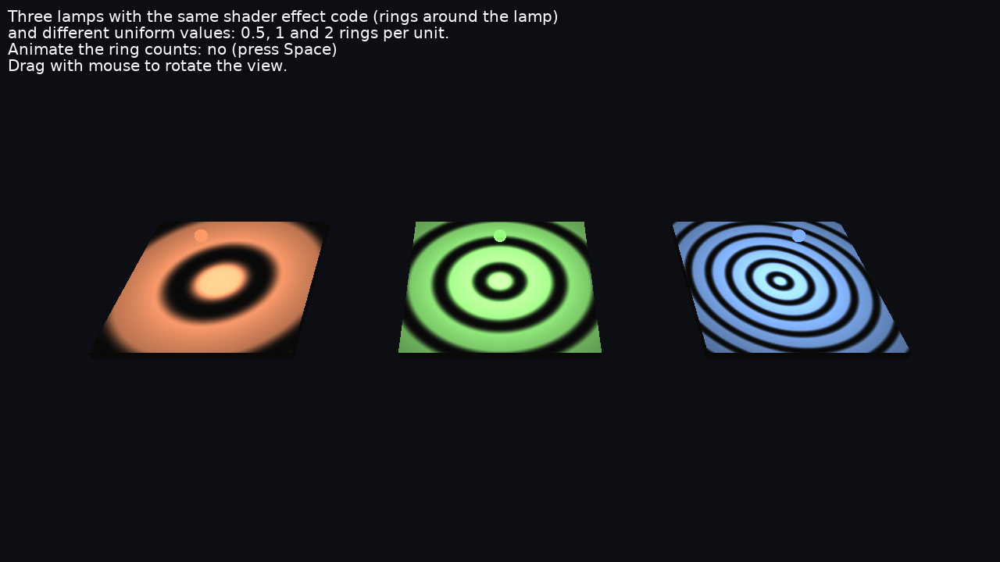

# Shader Effects On Several Lights

Several light sources with **the same shader effect code** and **different uniform values**.

Three lamps light three floor tiles. Each lamp has an `Effect` node (in the light's `effects` field) with the same GLSL code, [data/shaders/rings_light.fs](data/shaders/rings_light.fs): the light shines in rings around the lamp. The effects differ only in the values of their fields, which are uniforms in the shader: the lamp position (`lamp_position`) and the number of rings (`ring_count`: 0.5, 1 and 2 rings per unit). So every tile shows its own rings.



Keys:

- _Space_: animate the ring counts (changes the `ring_count` field of each effect with `Send`).
- Drag with the mouse to rotate the view.

## How it works

X3D light nodes have an `effects` field (see [Compositing Shaders in X3D](https://castle-engine.io/compositing_shaders.php)). An `Effect` there can define `PLUG_light_scale`, called for every point lit by this light, to scale the light's contribution:

```glsl
void PLUG_light_scale(inout float scale, const in vec3 normal_eye, const in vec3 light_dir)
```

The fields of the `Effect` node become uniforms:

```delphi
Effect := TEffectNode.Create;
Effect.Language := slGLSL;
Effect.AddCustomField(TSFVec3f.Create(Effect, true, 'lamp_position', Position));
RingCount := TSFFloat.Create(Effect, true, 'ring_count', 1);
Effect.AddCustomField(RingCount);
Part := TEffectPartNode.Create;
Part.ShaderType := stFragment;
Part.SetUrl(['castle-data:/shaders/rings_light.fs']);
Effect.SetParts([Part]);

Light := TPointLightNode.Create;
Light.SetEffects([Effect]);
```

All lamps are in one scene. Every lamp has a `radius` that reaches only its own tile, so every tile is lit by a different light (CGE gives a shape only the lights whose radius reaches its bounding box).

The shader computes the world position of the lit point from `castle_vertex_eye` and `castle_CameraInverseMatrix`. The latter comes from the `EyeWorldSpace` shader library, enabled by an `Effect` (without code) at the scene root, and `castle_vertex_eye` needs Phong shading (`Scene.RenderOptions.PhongShading := true`).

To change a uniform later, `Send` a new value to the field (`RingCount.Send(...)`), with `Scene.ProcessEvents := true`.

## Effects and shader programs

The renderer shares a shader program between shapes when the program would be the same. Effects are part of a program's identity **by node**, not by their code: two shapes can share a program only if they use the same `Effect` nodes. This matters because the uniform values of an effect are set when the program is linked (and when a field changes), not before rendering each shape. Effects with the same code but different uniform values (like the lamps here) need separate programs.

This was already done for effects on materials (`Appearance.effects`), on groups (`Group.effects`, like the `EyeWorldSpace` one) and on textures. It is now also done for **effects on lights**. Before, shapes whose lights had the same type and settings shared one program, so the first rendered shape's light effects (and their uniforms) were used for all of them. In this example the two other tiles showed the first lamp's rings, centered on the first lamp:

| Before (the 2nd and 3rd tiles use the 1st lamp's effect) | Now |
|---|---|
|  |  |

A consequence: every set of light effects a shape is lit by makes a separate shader program. With many lights that each have their own `Effect` node, many programs may be compiled; use the same `Effect` node (X3D `DEF` / `USE`) in lights whose uniforms are the same.

## Building

Compile by:

- [CGE editor](https://castle-engine.io/editor). Just use menu items _"Compile"_ or _"Compile And Run"_.

- Or use [CGE command-line build tool](https://castle-engine.io/build_tool). Run `castle-engine compile` in this directory.

- Or use [Lazarus](https://www.lazarus-ide.org/). Open in Lazarus `shader_effects_on_several_lights_standalone.lpi` file and compile / run from Lazarus. Make sure to first register [CGE Lazarus packages](https://castle-engine.io/lazarus).

- Or use [Delphi](https://www.embarcadero.com/products/Delphi). Open in Delphi `shader_effects_on_several_lights_standalone.dproj` file and compile / run from Delphi. See [CGE and Delphi](https://castle-engine.io/delphi) documentation for details.
