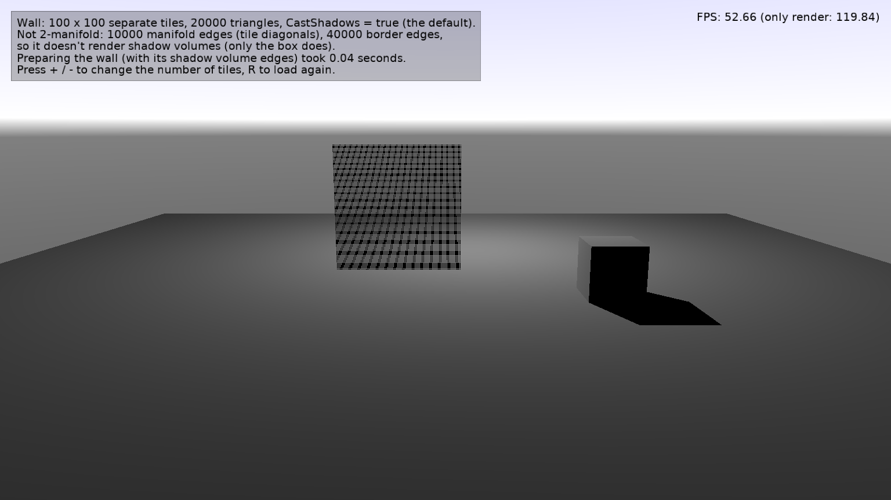

# Shadow Volumes: Large Open Caster

Loads a large mesh that is not 2-manifold into a viewport that uses [shadow volumes](https://castle-engine.io/shadow_volumes), and measures how long [PrepareResources](https://castle-engine.io/api?id=TCastleViewport.PrepareResources) takes for it.

Keys:

- _+_ / _-_: change the number of tiles.
- _R_: load the wall again.

## How it works

The design file has a light with shadows, a ground plane, a box that casts a shadow, and an empty `SceneWall`. The code ([code/gameviewmain.pas](code/gameviewmain.pas)) loads into `SceneWall` a wall of separate tiles. Like typical level geometry, it is not 2-manifold: most of its edges are _border edges_.

Preparing a scene for shadow volumes pairs up the edges of its shapes, to know which shapes are 2-manifold and can cast shadows. This happens for any scene with the default [CastShadows](https://castle-engine.io/api?id=TCastleTransform.CastShadows) = `true`. The edges are paired using a hash map (linear time); before, this was quadratic in the number of border edges:

| Wall | Before | After |
| --- | --- | --- |
| 100 x 100 tiles (40 000 border edges) | 1.81 s | 0.05 s |
| 150 x 150 tiles (90 000 border edges) | 10.23 s | 0.08 s |
| 300 x 300 tiles (360 000 border edges) | (minutes) | 0.34 s |

(Windows x86_64, FPC 3.2.2, release build.)

## Building

Compile by:

- [CGE editor](https://castle-engine.io/editor). Just use menu items _"Compile"_ or _"Compile And Run"_.

- Or use [CGE command-line build tool](https://castle-engine.io/build_tool). Run `castle-engine compile` in this directory.

- Or use [Lazarus](https://www.lazarus-ide.org/). Open in Lazarus `shadow_volumes_large_open_caster_standalone.lpi` file and compile / run from Lazarus. Make sure to first register [CGE Lazarus packages](https://castle-engine.io/lazarus).

- Or use [Delphi](https://www.embarcadero.com/products/Delphi). Open in Delphi `shadow_volumes_large_open_caster_standalone.dproj` file and compile / run from Delphi. See [CGE and Delphi](https://castle-engine.io/delphi) documentation for details.
