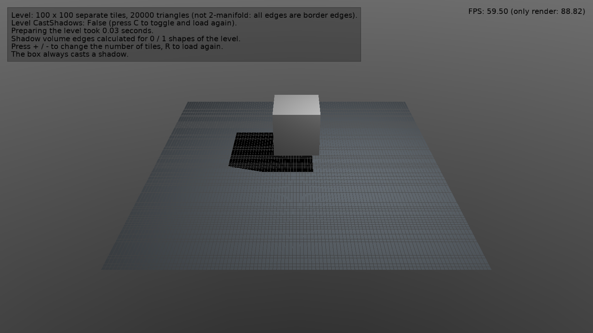

# Shadow Volumes: Large Scene That Doesn't Cast Shadows

Loads a large level into a viewport that uses [shadow volumes](https://castle-engine.io/shadow_volumes), and measures how long [PrepareResources](https://castle-engine.io/api?id=TCastleViewport.PrepareResources) takes for it. The level doesn't cast shadows ([CastShadows](https://castle-engine.io/api?id=TCastleTransform.CastShadows) = `false`).

Keys:

- _C_: toggle the level's `CastShadows` and load it again.
- _+_ / _-_: change the number of tiles.
- _R_: load the level again.

## How it works

The design file has a light with shadows, a box that casts a shadow, and an empty `SceneLevel`. The code ([code/gameviewmain.pas](code/gameviewmain.pas)) loads into `SceneLevel` a floor of separate tiles. Like typical level geometry, it is not 2-manifold: every edge is a _border edge_.

Preparing a scene for shadow volumes calculates the manifold and border edges of its shapes, which is slow for such meshes. A scene that doesn't cast shadows doesn't need them, so they are only calculated when `CastShadows` is `true`:

| Level | `CastShadows` = `false` | `CastShadows` = `true` |
| --- | --- | --- |
| 100 x 100 tiles (20 000 triangles) | 0.03 s | 1.6 s |
| 150 x 150 tiles (45 000 triangles) | 0.02 s | 13 s |

(Windows x86_64, FPC 3.2.2, release build.)

## Building

Compile by:

- [CGE editor](https://castle-engine.io/editor). Just use menu items _"Compile"_ or _"Compile And Run"_.

- Or use [CGE command-line build tool](https://castle-engine.io/build_tool). Run `castle-engine compile` in this directory.

- Or use [Lazarus](https://www.lazarus-ide.org/). Open in Lazarus `shadow_volumes_non_casting_scene_standalone.lpi` file and compile / run from Lazarus. Make sure to first register [CGE Lazarus packages](https://castle-engine.io/lazarus).

- Or use [Delphi](https://www.embarcadero.com/products/Delphi). Open in Delphi `shadow_volumes_non_casting_scene_standalone.dproj` file and compile / run from Delphi. See [CGE and Delphi](https://castle-engine.io/delphi) documentation for details.
