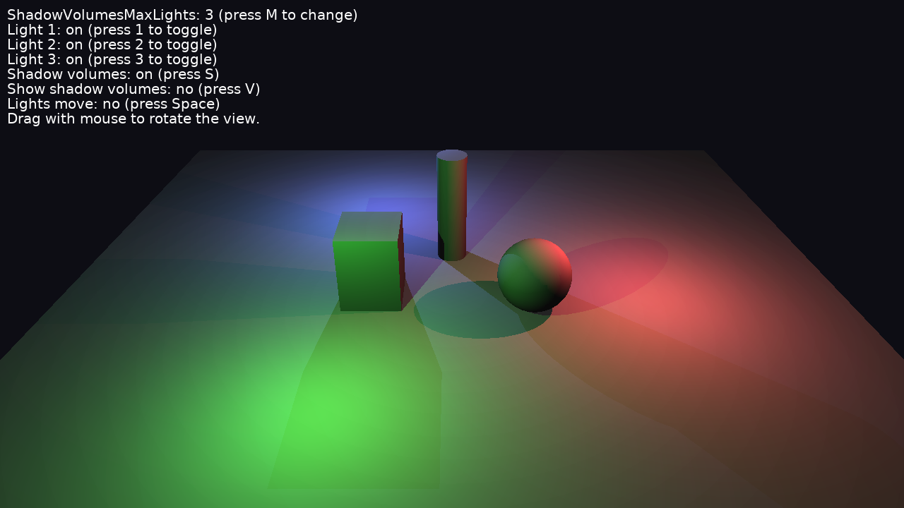

# Shadow Volumes From Several Lights

[Shadow volumes](https://castle-engine.io/shadow_volumes) cast by more than one light at the same time, using [TCastleViewport.ShadowVolumesMaxLights](https://castle-engine.io/api?id=TCastleViewport.ShadowVolumesMaxLights).

Keys:

- _M_: switch `ShadowVolumesMaxLights` between 3 and 1.
- _1_, _2_, _3_: turn a light on / off.
- _S_: shadow volumes on / off.
- _V_: show the shadow volumes.
- _Space_: stop / resume moving the lights.
- Drag with the mouse to rotate the view (follows [TCastleExamineNavigation](https://castle-engine.io/api?id=TCastleExamineNavigation)).

## How it works

The design file has three colored [TCastlePointLight](https://castle-engine.io/api?id=TCastlePointLight) lights with [Shadows](https://castle-engine.io/api?id=TCastlePunctualLight.Shadows) = `true`, a few objects that cast shadows, and a viewport with `ShadowVolumesMaxLights` = 3. So every object casts three shadows, and each shadow is lit by the other two lights. With `ShadowVolumesMaxLights` = 1 (the default) only one light casts shadows, and the other lights are turned off inside its shadow.

The code ([code/gameviewmain.pas](code/gameviewmain.pas)) only moves the lights and handles the keys.

The objects use Phong materials: see the [ShadowVolumesMaxLights](https://castle-engine.io/api?id=TCastleViewport.ShadowVolumesMaxLights) documentation about gamma correction and the other limitations.

## Building

Compile by:

- [CGE editor](https://castle-engine.io/editor). Just use menu items _"Compile"_ or _"Compile And Run"_.

- Or use [CGE command-line build tool](https://castle-engine.io/build_tool). Run `castle-engine compile` in this directory.

- Or use [Lazarus](https://www.lazarus-ide.org/). Open in Lazarus `shadow_volumes_several_lights_standalone.lpi` file and compile / run from Lazarus. Make sure to first register [CGE Lazarus packages](https://castle-engine.io/lazarus).

- Or use [Delphi](https://www.embarcadero.com/products/Delphi). Open in Delphi `shadow_volumes_several_lights_standalone.dproj` file and compile / run from Delphi. See [CGE and Delphi](https://castle-engine.io/delphi) documentation for details.
